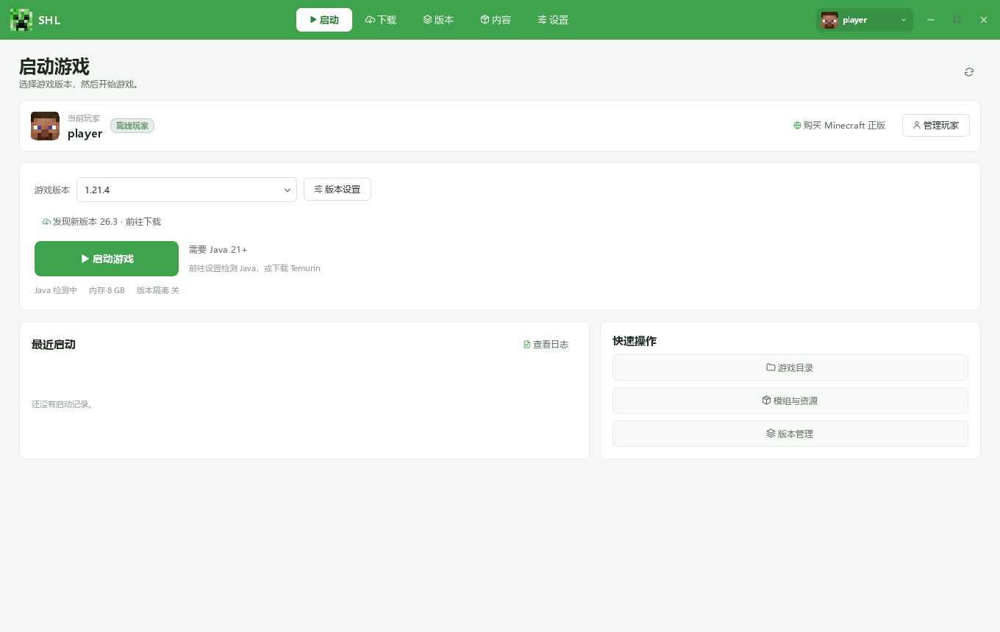
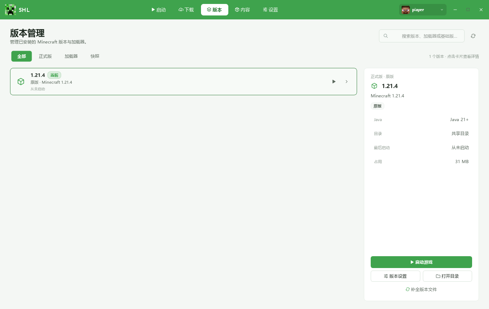
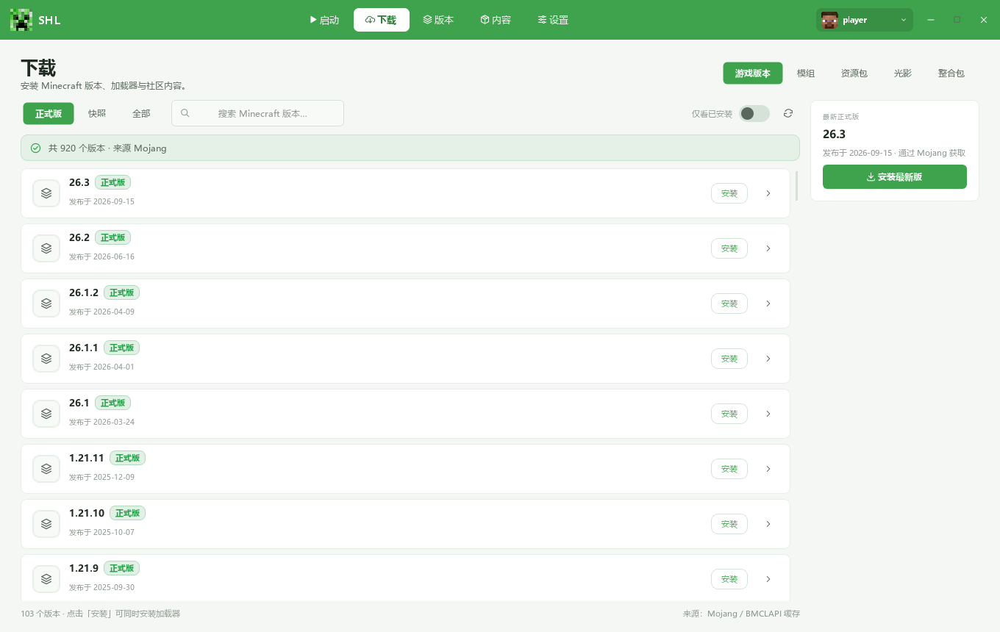
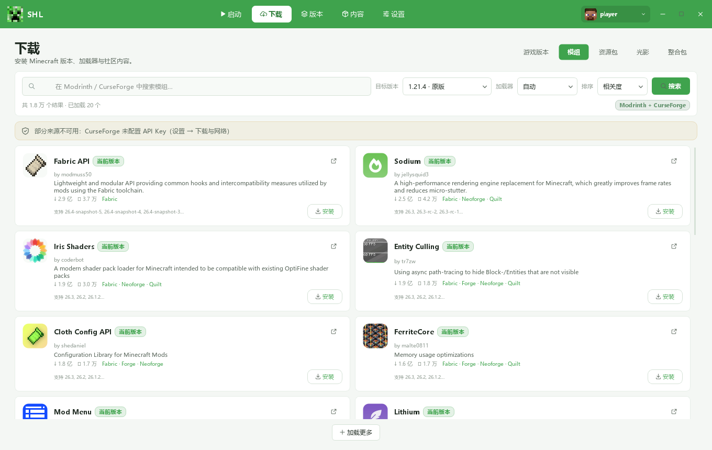
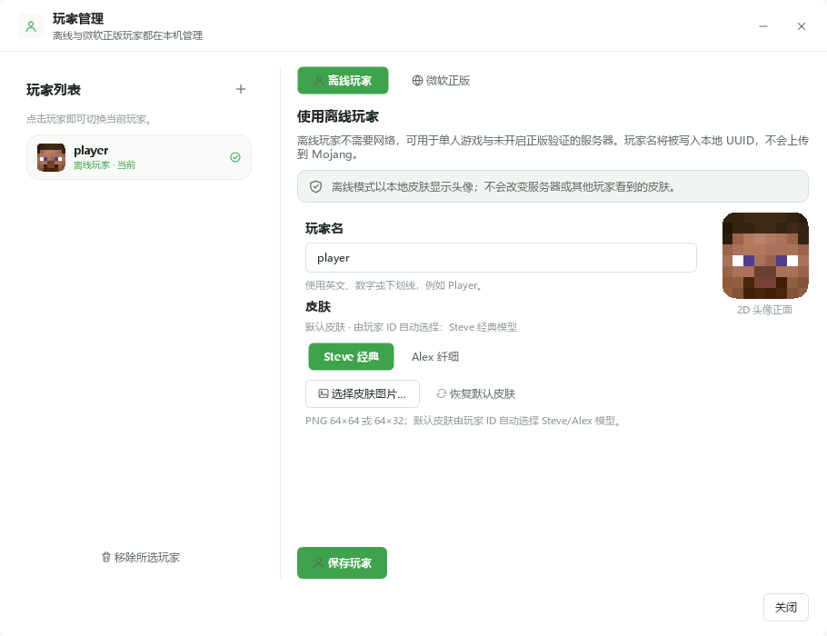

# SHL · 机械冒险港启动器

当前版本：**26-alpha-B.11** · Windows 10 / 11 64 位

> 下载 exe：在本仓库的 **Releases** 页面获取 `SHL-26-alpha-B.10.exe`。

SHL 是一个 Minecraft 启动器，使用 Python + PyQt6 编写。拥有启动、下载、
版本隔离、模组与整合包管理、账号和 Java 设置的功能，默认苦力怕绿主题，
也可以切换其他主题。



## 主要功能

### 启动与版本隔离

- 选择已安装的 Minecraft 版本，一键启动。
- 每个版本可以使用独立的 `mods`、`config`、`saves` 目录，互不污染。
- 自动检测 Java；也可以手动指定 Java 路径。
- 可调内存、GC、JVM 参数和游戏窗口大小。
- 记录最近启动与日志，出问题可以直接查看。



### 下载与安装

- 安装正式版、快照和旧版本。
- 同时安装 Fabric、Quilt、Forge、NeoForge 等加载器。
- 支持 Mojang 官方源和 BMCLAPI 镜像，可并行下载。
- 下载页直接显示版本列表和安装状态。



### 模组、资源包与光影

- 管理已安装的模组、资源包、光影和存档，可启用/禁用。
- 支持把 `.jar` 直接拖进内容工坊。
- 从 Modrinth 搜索并安装模组；配置 CurseForge API Key 后也可搜索 CurseForge。
- 导入/导出整合包，整合包会带上对应的模组和配置。



### 账号与皮肤

- **离线玩家**：不需要网络，输入玩家名即可；示例名 **player**。
- **微软正版**：设备代码登录，在浏览器里完成，不需要安装 Azure 工具，
  启动器也不会接触密码。
- 支持 Steve 经典 / Alex 纤细模型，可选择本地 64×64 或 64×32 皮肤 PNG。
- 玩家列表可保存多个账号并切换。



### 界面与其他

- 苦力怕绿 / 象牙白两套主题。
- 首页、版本、下载、内容、设置五个主页面。
- 游戏目录、日志目录、数据目录都可以直接打开。
- 内置自检和日志，方便排查启动问题。

## 运行

### 使用 exe

双击 `SHL-26-alpha-B.10.exe`。首次启动会在 exe 旁边创建：

```text
.SHL\
  version.json
  runtime\26.10.21.10\
  data\
  logs\
  cache\
```

运行时解包到 `.SHL\runtime`，不会在 exe 旁边生成 `.shl-runtime`。

### 从源码运行

需要 Windows 10/11 64 位、Python 3.11+（在 Python 3.12 上验证）。

```powershell
python -m pip install -r requirements.txt
python main.py
```

源码目录只包含启动器本身：

```text
source\
  app\
  icons\
  licenses\
  vendor\
  main.py
  requirements.txt
  LICENSE
  THIRD_PARTY_NOTICES.md
```

`vendor\minecraft_launcher_lib` 是 Forge 官方安装处理器需要的运行库；
其余依赖由 `requirements.txt` 安装。

## 环境要求

- Windows 10 / 11 64 位
- Python 3.11+（源码运行）
- Java 21+（Minecraft 1.20.5 及以后；启动器可检测并引导安装）
- 首次下载需要网络

## 已知限制

- 单文件 exe 首次启动需要解包运行时，会比后续启动慢。
- 没有代码签名，Windows SmartScreen 可能提示。
- 未配置 CurseForge API Key 时，只搜索 Modrinth。
- 界面里的中文版本名只是显示名称，不改变 `versions\<id>` 文件夹。

## 开源与素材

- 启动器原创代码：**GNU GPL v3.0**，全文见 `LICENSE`。
- Minecraft 素材与图标：© Mojang Studios / Microsoft，不适用 GPL，
  仅用于界面展示；详见 `THIRD_PARTY_NOTICES.md`。
- 第三方库：PyQt6 / Qt（GPL-3.0）、minecraft-launcher-lib（BSD-2-Clause）
  等，完整说明见 `THIRD_PARTY_NOTICES.md`。

## AI 生成内容披露

该项目完全使用Deepseek-V4.1-flash和Deepseek Harness开发，无任何人工代码。
